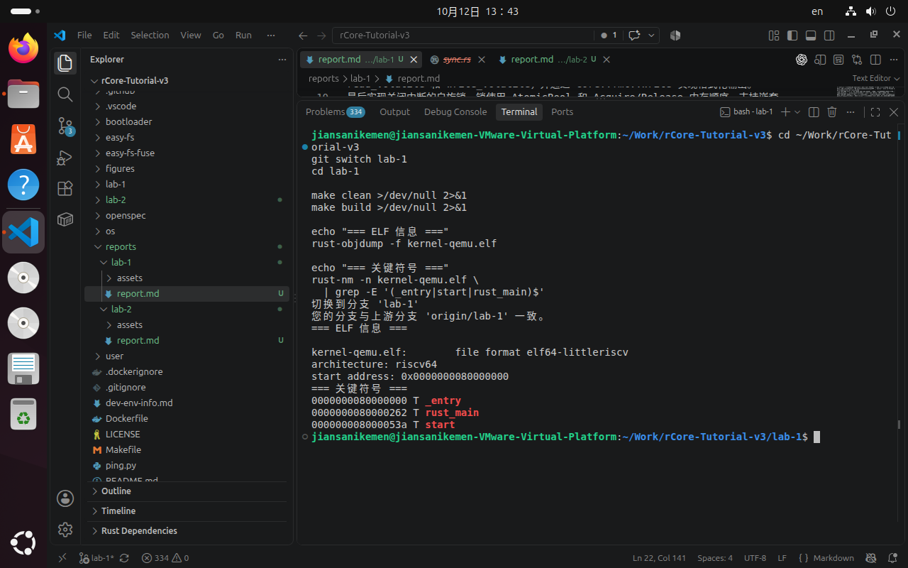
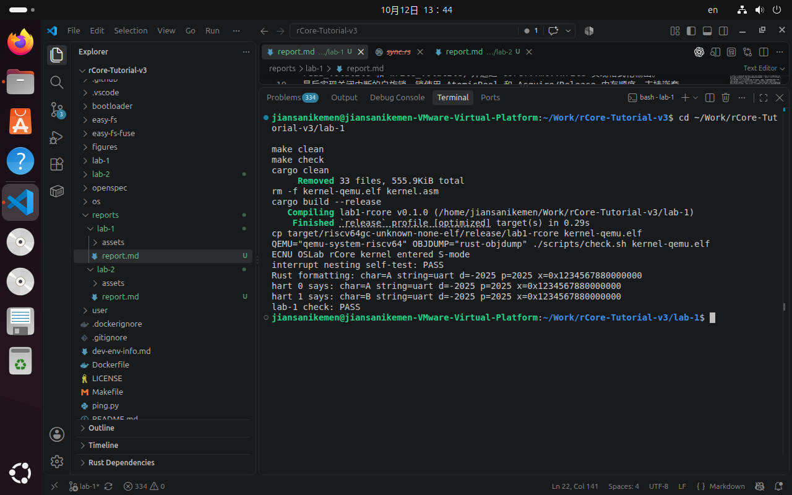

# Lab 1：机器启动与基础运行时

## 一、实验目的

本实验使用 Rust 编写运行在 RISC-V 架构上的裸机内核，完成机器启动、特权级切换、UART 串口输出、中断控制和自旋锁基础功能。

## 二、实验环境

- Ubuntu 24.04 LTS
- Rust 1.98.1
- RISC-V 目标：`riscv64gc-unknown-none-elf`
- QEMU 8.2.2
- VMware Workstation Pro 17

## 三、主要实现内容

1. 配置项目编译目标、链接脚本和 QEMU 启动参数。
2. 在 `entry.S` 中设置启动入口和每个 hart 的独立栈空间。
3. 在 `main.rs` 中完成机器态到监督态的切换。
4. 配置 `mstatus`、`mepc`、`satp`、PMP 和 `tp` 等 RISC-V 控制寄存器。
5. 在 `uart.rs` 中初始化 UART，并实现字符输出。
6. 在 `console.rs` 中实现格式化输出宏。
7. 在 `sync.rs` 中实现中断控制和自旋锁基础结构。

## 四、实验过程与结果

使用 `make build` 成功编译内核并生成 RISC-V ELF 文件；使用 `make check` 完成 ELF 结构、符号、反汇编和 QEMU 运行检查。

QEMU 输出如下，说明内核能够正常启动并完成 UART 输出：

```text
Rust formatting: char=A string=uart d=-2025 p=2025 x=0x1234567880000000
QEMU: Terminated
```

## 五、实验截图





## 六、实验总结

本实验完成了从程序入口到 Rust 内核主函数的启动流程，理解了 RISC-V 特权级、控制寄存器、UART 内存映射 I/O 以及 QEMU 裸机运行环境。通过 ELF 检查和 QEMU 验证，确认内核能够被正确编译、链接和执行。
