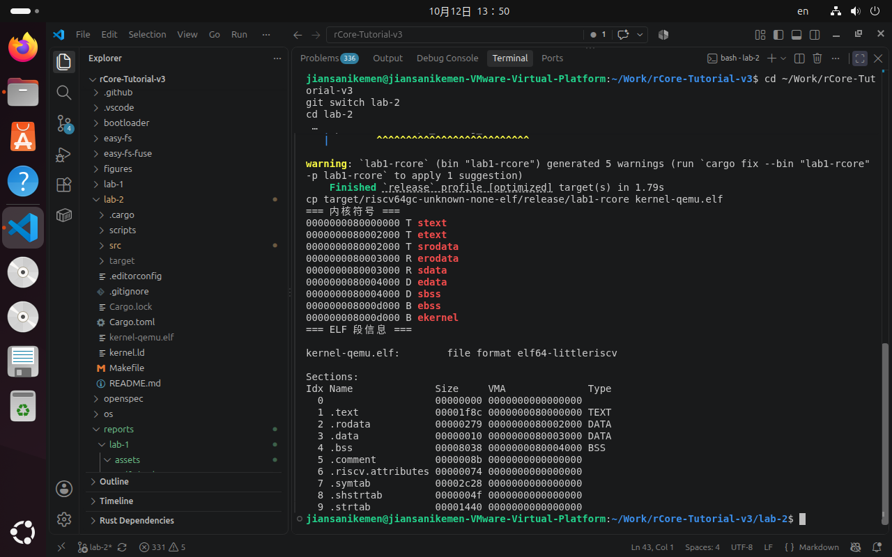
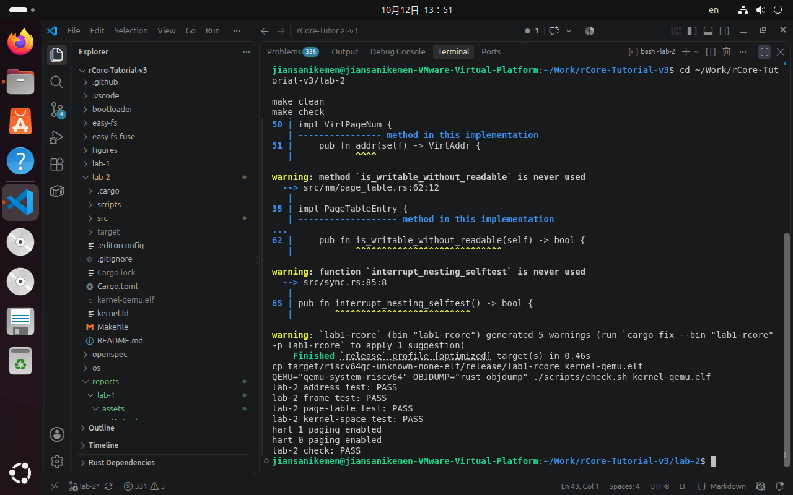

# Lab 2：内存管理

## 一、实验目的

本实验在 Lab 1 裸机启动环境的基础上，实现 RISC-V 内核的地址抽象、物理页帧分配、页表映射和内核地址空间初始化，理解虚拟地址到物理地址的转换过程。

## 二、实验环境

- Ubuntu 24.04 LTS
- Rust 1.98.1
- RISC-V 目标：`riscv64gc-unknown-none-elf`
- QEMU 8.2.2
- VMware Workstation Pro 17

## 三、主要实现内容

1. 在 `src/mm/address.rs` 中实现虚拟地址、物理地址、虚拟页号和物理页号抽象，完成页号计算、页内偏移和三级页表索引。
2. 在 `src/mm/frame_allocator.rs` 中实现物理页帧分配器，维护空闲页帧范围，分配时清零，释放时检查重复释放和越界情况。
3. 在 `src/mm/page_table.rs` 中实现 Sv39 页表，完成中间页表创建、页表项映射、取消映射和只读查询，并拒绝重复映射和非法的 W-only 权限。
4. 在 `src/mm/memory_set.rs` 中建立内核地址空间，映射内核代码、只读数据、可写数据和 BSS 区域，并生成 `satp` 页表令牌。
5. 在 `src/mm/mod.rs` 中组织地址、页帧、页表和内核地址空间测试。
6. 在 `entry.S` 中为启动栈预留空间，保证内核初始化过程具有足够的栈容量。

## 四、实验过程与结果

使用 `make build` 成功编译内核，生成 `kernel-qemu.elf`。ELF 符号和段信息表明内核各区域按链接脚本正确排列：代码段从 `stext` 开始，BSS 段结束于 `ebss`，内核末地址为 `ekernel`。

运行自动检查后，地址转换、页帧分配、页表映射、内核地址空间初始化和 QEMU 启动测试均通过。

## 五、实验截图

## 六、实验总结

本实验完成了内核内存管理的基础功能。通过地址类型封装降低了地址运算错误的风险，通过页帧分配器管理物理内存，通过 Sv39 页表建立虚拟地址映射，最终形成了可供内核使用的地址空间。实验加深了对分页机制、页表项权限和内核内存布局的理解。
