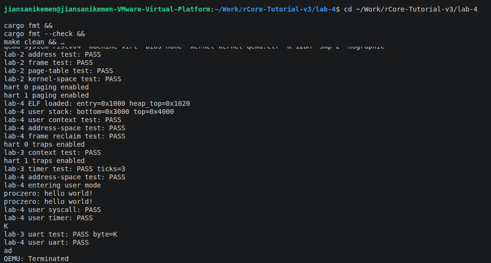
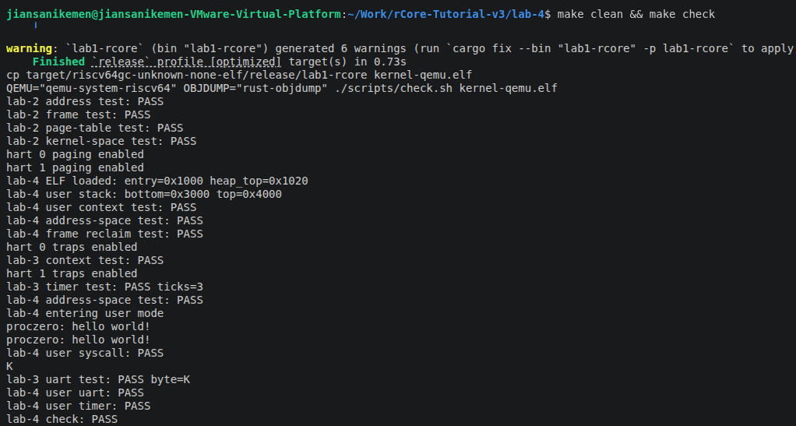

# Lab 4：首个用户进程

## 一、实验目的

在 Lab 3 内核基础上装载 RISC-V ELF，建立独立用户地址空间，通过上下文切换进入 U-mode，处理用户系统调用，并验证用户态运行期间时钟和 UART 中断仍然可用。

## 二、实验环境

- Ubuntu 24.04 LTS，VMware Workstation Pro 17
- Rust 1.98.1，目标：`riscv64gc-unknown-none-elf`
- QEMU 8.2.2，`virt` 平台，双 hart、128 MiB 内存

## 三、主要实现内容

1. 在 `process.rs` 中校验 ELF 文件头和程序头，检查边界、段权限及入口位置；逐页分配内存并复制 LOAD 段内容，文件数据以外的区域保持清零。
2. 建立独立用户页表，映射用户代码、用户栈、TrapContext 和共享 trampoline；保留未映射的 guard page，禁止用户访问 UART、PLIC 和内核栈，并验证进程销毁后的页帧回收。
3. 区分 `TaskContext` 与 `UserTrapContext`，分别初始化内核切换现场和用户返回现场，通过 `__switch`、`trap_return` 与 `sret` 从 ELF 入口进入 U-mode。
4. 实现用户 Trap 汇编的寄存器保存恢复、页表切换和内核栈切换；处理两次 hello 系统调用，仅对 `ecall` 将保存的 `sepc` 增加 4，并复用 Lab 3 的时钟、PLIC 和 UART 功能。

## 四、实验过程与结果

初次运行自检时，反汇编显示 `rust_main` 栈帧为 21344 字节，超过原有 16 KiB 启动栈。将每 hart 启动栈扩大到 64 KiB，并为自检函数添加 `#[inline(never)]` 后恢复正常。地址空间、用户上下文和页帧回收测试均通过。

执行 `cargo fmt --check` 和 `make clean && make check`，自动验收通过；手工确认字符回显、退格和换行正常。关键输出如下：

```text
lab-4 address-space test: PASS
proczero: hello world!
proczero: hello world!
lab-4 user syscall: PASS
lab-4 user timer: PASS
lab-4 user uart: PASS
lab-4 check: PASS
```

## 五、实验截图





## 六、实验总结

本实验完成了首个用户进程从 ELF 装载到用户态执行、陷入内核并返回的完整流程。通过共享跳板解决页表切换时的连续取指问题，通过权限隔离、独立栈和现场保存维护内核与用户程序的边界，也加深了对系统调用返回位置及栈空间需求的理解。
